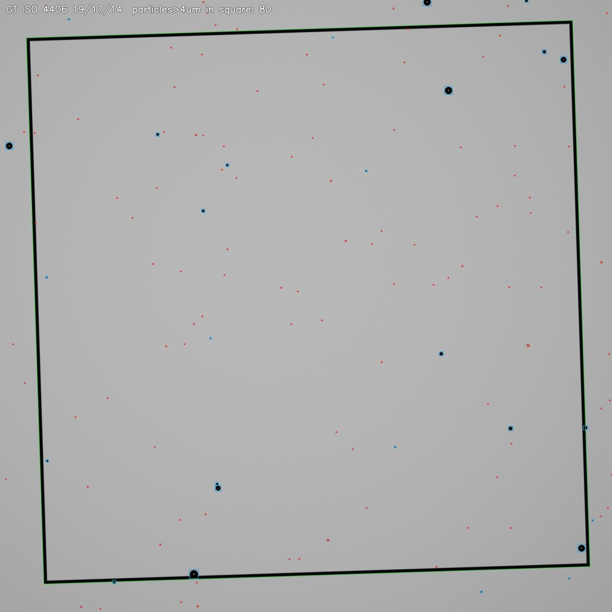
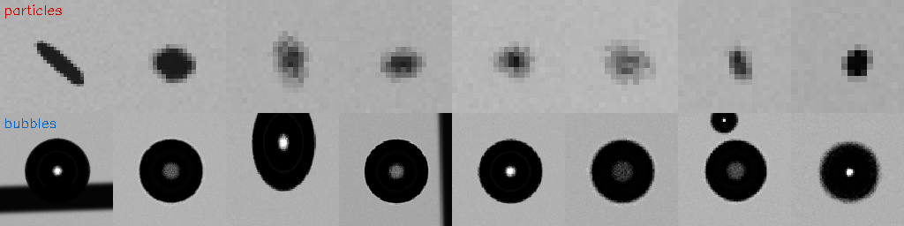

# FluidSim — Optical Physics Image Simulator for ISO 4406 Particle Counting

FluidSim generates synthetic bright-field microscope images of a thin film of oil between two glass plates. The film contains solid particles and air bubbles. Every image comes with exact ground truth: the position, size and class of each object, plus the ISO 4406 code that a perfect counter should report.

The images are meant for developing and benchmarking a vision-based ISO 4406 particle counter. Ground truth is exact and free, and you can vary every physical parameter.



*A full 5600 × 5600 px (31 MP) image at 2 µm/px, with ground truth overlaid. Red boxes are solid particles, blue boxes are air bubbles, and the green outline is the 1 cm × 1 cm reference square. Target cleanliness 19/17/14.*

## What it simulates

| Element | Model |
|---|---|
| Cell | Oil film (default 200 µm, n = 1.47) sandwiched between a background glass and a cover glass |
| Reference square | 10.000 mm × 10.000 mm chrome outline (60 µm line) printed on the background glass. It has a random small rotation and offset, and is rendered out of focus because it sits below the focal plane |
| Solid particles | Opaque, irregular thin flakes at random depths. Sizes follow ISO 4407 (longest dimension, maximum Feret diameter) and cover the ISO 4406 channels > 4, > 6 and > 14 µm(c), up to 150 µm |
| Air bubbles | Spheres (n = 1.00) that are **ray traced** with Fresnel reflection and refraction. The bright centre, the dark ring and the **edge glow** all come out of the physics; none of them is painted on |
| Illumination | Köhler-style illumination with a finite condenser cone, plus vignetting and a linear tilt |
| Imaging | NA 0.25 objective. Rays are imaged at the focal plane, then blurred by a Gaussian diffraction PSF |
| Sensor | Poisson shot noise, Gaussian read noise and quantisation to 8 or 16 bits |
| Flow | Plane Poiseuille profile between the plates, used for time sequences and optional motion blur |



*Top row: solid particles are dark and have soft, defocus-dependent edges. Bottom row: air bubbles show a dark ring from total internal reflection, a bright lens-like centre and a thin rim that is brighter than the background.*

### Physics summary (default config)

Output of `fluidsim info -c configs/default.yaml`:

| Quantity | Value |
|---|---|
| Field of view | 11.2 × 11.2 mm (5600 × 5600 px at 2.0 µm/px) |
| Counting volume (square interior × film) | 0.01952 mL |
| Target counts per mL (> 4 / > 6 / > 14 µm) | 3535.5 / 912.1 / 113.1 → **19/17/14** |
| Expected particles inside the square | 69.0 / 17.8 / 2.2 |
| Critical angle, oil → air | 42.86° |
| Lateral resolution, 0.61 λ/NA | 1.34 µm |
| PSF σ | 0.231 px |
| Depth of field, λn/NA² | 12.9 µm |
| Defocus blur σ at the film surface | 4.1 µm |

The theory, equations and approximations are in [docs/physics.md](docs/physics.md).

## Quick start

```bash
pip install -e .            # Python 3.10+
fluidsim info -c configs/default.yaml
```

```bash
# 10 full-resolution images with masks, YOLO labels and annotated previews
fluidsim generate -c configs/default.yaml -n 10 -o out/clean --masks --yolo --previews
```

```bash
# fast preset (4 um/px) for prototyping
fluidsim generate -c configs/quick.yaml -n 50 -o out/quick
```

```bash
# aerated, heavily contaminated oil
fluidsim generate -c configs/dirty_oil_with_foam.yaml -n 10 -o out/foam
```

```bash
# a flowing film: 25 frames with persistent object ids plus a lossless AVI
fluidsim sequence -c configs/flow_sequence.yaml --frames 25 --video -o out/seq
```

```bash
# override any config value from the command line
fluidsim generate -c configs/default.yaml -n 5 -o out/x --set population.target_iso_code=17/15/12 --set image.bit_depth=16
```

```bash
# ISO 4406 code from raw counts in a known volume
fluidsim iso 80 17 2 --volume-ml 0.01952      # -> 19/17/14
```

## Output layout

```text
out/clean/
├── images/img_00000.png      # sensor image (8- or 16-bit grayscale)
├── labels/img_00000.json     # full ground truth for that image
├── annotations.csv           # one row per object across the whole dataset
├── masks/img_00000.png       # (--masks) uint16 instance mask, 0 = background, id+1 = object
├── yolo/img_00000.txt        # (--yolo) class cx cy w h, normalised; 0 = particle, 1 = bubble
├── previews/img_00000.jpg    # (--previews) annotated, downscaled preview
└── dataset.json              # resolved config, generation time and dataset summary
```

Each label JSON records the reference square's outer corners in pixels, the true µm/px, and every object's class, position (px and µm), depth, size (maximum Feret), equivalent circular diameter, bounding box, ISO channel membership, flow velocity and whether it lies inside the counting area. It also includes the **ground-truth ISO 4406 code**. The full schema is in [docs/ground_truth_format.md](docs/ground_truth_format.md).

## Configuration reference

Configs are YAML files layered on top of the defaults in `src/fluidsim/config.py`. Unknown keys are rejected, and `--set key.sub=value` overrides any field.

| Key | Default | Meaning |
|---|---|---|
| `seed` | 0 | Base random seed. Image *k* uses `seed * 1000003 + k` |
| `optics.wavelength_nm` | 550 | Illumination wavelength (sets the PSF) |
| `optics.objective_na` | 0.25 | Collection NA. Rays outside it are lost |
| `optics.condenser_na` | 0.12 | Half-angle of the illumination cone (sets defocus blur) |
| `optics.n_liquid` / `n_bubble` | 1.47 / 1.00 | Refractive indices of the oil and the bubble gas |
| `optics.focus_depth_um` | null (mid-film) | Height of the focal plane in the film |
| `optics.rays_per_pixel` | 32 | Stratified samples per pixel inside object patches |
| `optics.max_ray_depth` | 8 | Reflection/refraction events followed per primary ray |
| `cell.film_thickness_um` | 200 | Gap between the glass plates |
| `cell.reference_square_mm` | 10 | Outer edge of the printed square |
| `cell.square_line_width_um` | 60 | Width of the printed line |
| `cell.square_rotation_deg_max` / `square_offset_um_max` | 2 / 150 | Random placement range of the square |
| `image.pixel_size_um` | 2.0 | Object-space sampling |
| `image.width_px` / `height_px` | 5600 | Must be large enough to contain the whole square |
| `image.bit_depth` | 8 | 8 or 16 |
| `sensor.full_well_e` / `read_noise_e` | 12000 / 6 | Noise model |
| `sensor.background_level` | 0.72 | Mean illumination as a fraction of full scale |
| `sensor.vignetting` / `illumination_gradient` | 0.10 / 0.04 | Flat-field non-uniformity |
| `sensor.exposure_ms` | 0.5 | Sets motion-blur length in flow |
| `population.target_iso_code` | "19/17/14" | Target cleanliness |
| `population.counts_per_ml` | null | Explicit [> 4, > 6, > 14] counts per mL. Takes precedence over the target code |
| `population.particle_size_max_um` | 150 | Upper size cut-off |
| `population.particle_aspect_range` | [1.0, 2.2] | Elongation of the particle flakes |
| `population.particle_transmission_range` | [0.02, 0.18] | Residual transmission of the flakes |
| `population.bubble_count` | 30 | Mean number of bubbles per image (Poisson) |
| `population.bubble_diameter_range_um` | [12, 160] | Log-uniform. Must be smaller than the film |
| `population.bubbles_rise_to_top` | false | Puts bubbles against the cover glass |
| `flow.max_velocity_um_s` | 2000 | Centre-line velocity |
| `flow.direction_deg` / `frame_interval_ms` | 0 / 40 | Flow direction and frame interval for sequences |

## Performance

Measured on the author's laptop (Windows 11, Python 3.12, Numba 0.68, multi-core CPU):

| Preset | Image | Time per image |
|---|---|---|
| `default.yaml` | 5600 × 5600 px, 2 µm/px, 32 rays/px | ~15 s (~35 s for the first image, which includes ~20 s of Numba JIT compilation) |
| `quick.yaml` | 2800 × 2800 px, 4 µm/px, 12 rays/px | ~2 s (~6.5 s for the first image) |

Rays are only traced inside padded patches around objects. Overlapping patches are merged into clusters, and the empty background is handled analytically. That keeps the cost proportional to the number of objects rather than the sensor size.

## Tests

```bash
pip install -e .[dev]
pytest -q
```

The suite checks:

- ISO 4406 table boundaries and Fresnel limits (normal incidence, total internal reflection past the critical angle).
- Energy conservation: rays can lose energy but never gain it.
- An empty cell transmits 1.0 everywhere.
- A bubble has a bright centre, a dark ring and a rim brighter than the background, while an opaque particle never exceeds background.
- Particle sizes reproduce the ISO channel ratios.
- Ground-truth internal consistency, determinism, and end-to-end CLI runs.

## Limitations

These are deliberate simplifications:

- **Geometric optics.** Diffraction is approximated by a Gaussian PSF with σ = 0.21 λ/NA, not by wave-optical propagation. Interference fringes around bubbles and Airy rings are not reproduced.
- **Particles are thin planar absorbers** at one depth with a single transmission value. There is no 3-D shape, scattering, colour or partial transparency structure.
- **Bubbles are perfect spheres smaller than the film thickness.** Bubbles squeezed between the plates (pancake bubbles) are not modelled.
- **Planar interfaces are idealised.** Refraction at the glass plates and its spherical aberration are ignored, so imaging is effectively telecentric. The reference square's defocus uses an analytic blur, not ray tracing.
- **Refractive indices are fixed per run.** There is no dispersion, temperature dependence or variation in oil type within a dataset.
- The sensor model is generic and has not yet been calibrated against a specific camera.

## Roadmap

- Cross-check bubble profiles against a Blender/Cycles render of the same cell.
- Use a wave-optics (angular-spectrum) PSF for objects near the resolution limit.
- Calibrate the noise and flat-field model against real camera frames from the client rig.
- Add non-spherical bubbles squeezed by the plates, coalescing bubbles and fibre-shaped particles.
- Add domain randomisation presets for training learned detectors.

## Project history

This repository previously hosted a chart-detection research project. That code is preserved at tag `archive/chart-detection-v1`. The synthetic-data generation, ground-truth annotation and evaluation experience from that project carried over into this simulator.

The companion **ISO 4406 Vision-Based Particle Counter**, which consumes this ground truth, is at <https://github.com/likhith1253/MT-Dynamics>.

## Author

Likhith Ponnada. MIT License (see [LICENSE](LICENSE)).
