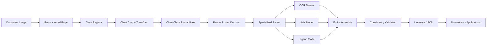

# Data Flow

## 1. Principle

The system should preserve traceability from document pixels to structured fields. Every downstream datum must be linkable to its upstream visual evidence.

## 2. Data Flow Diagram



## 3. Interface Contract by Boundary

### 3.1 Document Image to Preprocessing

Input:

- RGB page image

Output:

- RGB page image
- page-level metadata:
  - rotation
  - scale
  - noise score

### 3.2 Preprocessing to Chart Detection

Input:

- normalized page image

Output:

- chart region proposals:
  - bounding box
  - confidence
  - optional polygon

### 3.3 Detection to Cropping

Input:

- chart regions in page coordinates

Output:

- chart crop image
- affine transform from crop coordinates to page coordinates

### 3.4 Cropping to Classification

Input:

- chart crop image

Output:

- class probability vector

### 3.5 Classification to Router

Input:

- class probabilities
- calibration metadata

Output:

- parser id
- fallback policy

### 3.6 Router to Parser

Input:

- chart crop
- selected parser id
- transform metadata

Output:

- parser-local intermediate structures

### 3.7 Parser to OCR / Axis / Legend Submodules

Input:

- chart-local crop
- optional region proposals

Output:

- OCR tokens with coordinates
- axis primitives
- legend primitives

### 3.8 Submodules to Entity Assembly

Input:

- tokens
- axis primitives
- legend primitives
- geometric evidence

Output:

- normalized entities:
  - marks
  - series
  - coordinates
  - labels
  - statistics

### 3.9 Entity Assembly to Consistency Checker

Input:

- entity list

Output:

- validated entity list
- violation report

### 3.10 Consistency Checker to JSON

Input:

- validated entity list
- provenance links

Output:

- universal schema instance

## 4. Provenance Requirements

Every output object should preserve:

- source document id
- chart region id
- parser family
- coordinate transform
- confidence
- evidence references

This is essential for auditability and for reviewer trust.

## 5. Diagram of Nested Data Structures

```mermaid
sequenceDiagram
    participant Doc as Document
    participant Det as Detector
    participant Cls as Classifier
    participant Rtr as Router
    participant Par as Parser
    participant Ocr as OCR
    participant Ax as Axis
    participant Leg as Legend
    participant Val as Validator
    participant J as JSON

    Doc->>Det: page image
    Det->>Cls: chart crop
    Cls->>Rtr: class probabilities
    Rtr->>Par: parser selection
    Par->>Ocr: text regions / crop
    Par->>Ax: axis cues
    Par->>Leg: legend cues
    Ocr-->>Par: tokens
    Ax-->>Par: coordinate mapping
    Leg-->>Par: series mapping
    Par->>Val: provisional entities
    Val->>J: validated universal schema
```

