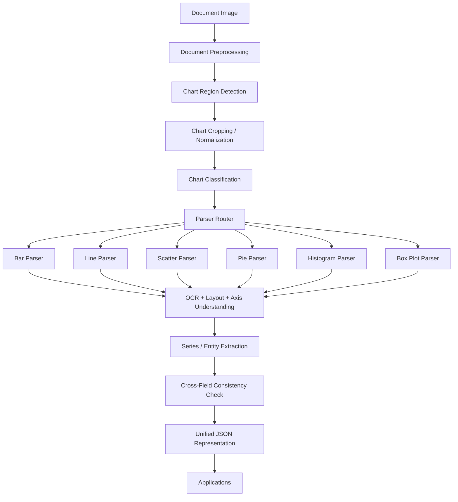

# System Architecture for Multi-Chart Document Understanding

## 1. Design Goal

The system is a document-to-structure pipeline for research-grade chart understanding. Its purpose is to convert chart-bearing document images into a normalized, machine-readable representation that supports multiple chart families:

- Bar
- Line
- Scatter
- Pie
- Histogram
- Box Plot

The architecture is intentionally modular. Each stage is responsible for one interpretable transformation, so the system can be analyzed, audited, and improved independently. This is crucial for publication because reviewers typically value composability, explainability, and cross-dataset generalization more than a monolithic end-to-end black box.

## 2. High-Level Pipeline

## 3. Stage-by-Stage Design

### 3.1 Document Preprocessing

Input: a full-page document image.

Role:

- Correct global orientation
- Denoise scans and screenshots
- Normalize contrast
- Detect page margins and high-level document structure

Why it matters:

- Chart extraction quality is limited by upstream page quality.
- Many document images contain multiple figures, captions, and surrounding text.

Output:

- Preprocessed document image
- Optional page metadata such as rotation angle and document quality score

### 3.2 Chart Region Detection

Input: preprocessed document image.

Role:

- Locate chart panels on the page
- Distinguish charts from tables, equations, illustrations, and paragraphs
- Return bounding boxes or polygons for each chart region

Key idea:

- The detector should be chart-type agnostic because the first goal is localization, not semantic parsing.
- The output may include confidence scores and overlap suppression for multi-chart pages.

Output:

- One or more chart region proposals

### 3.3 Chart Cropping and Normalization

Input: chart region proposals.

Role:

- Crop the chart region
- Standardize resolution and aspect ratio when needed
- Preserve original coordinates in metadata for later back-projection

Why it matters:

- Downstream parsers should operate in a chart-centric coordinate space.
- Geometry recovery must remain traceable to the original document.

Output:

- Normalized chart image
- Coordinate transform metadata

### 3.4 Chart Classification

Input: normalized chart image.

Role:

- Predict the chart family
- Produce one label from a controlled ontology:
  - `bar`
  - `line`
  - `scatter`
  - `pie`
  - `histogram`
  - `box_plot`

Research role:

- The classifier is not the end goal.
- It is a routing mechanism that selects the best parser family and provides a measurable first-stage benchmark.

Output:

- Chart family label
- Confidence distribution over classes

### 3.5 Parser Router

Input:

- chart family label
- classification confidence
- optional heuristics from layout/OCR

Role:

- Dispatch the chart image to a specialized parser
- Resolve ambiguous charts by confidence thresholds and rule-based fallback

Examples:

- Low-confidence classification can trigger a multi-parser vote.
- Mixed charts can be routed to the parser that maximizes structural likelihood.

Output:

- Parser selection decision

### 3.6 Chart-Specific Parser

The parser family performs chart-type-specific structural recovery. Each parser uses the same universal output schema but different internal logic.

#### Bar Parser

Recover:

- Bar instances
- Category labels
- Numeric values
- Orientation
- Grouping / stacking

#### Line Parser

Recover:

- Series identity
- Ordered x positions
- y values
- Missing-value gaps
- Markers, if present

#### Scatter Parser

Recover:

- Point coordinates
- Series grouping
- Marker style
- Optional trend-line or density structure

#### Pie Parser

Recover:

- Wedge boundaries
- Slice labels
- Relative proportions
- Category-to-slice mapping

#### Histogram Parser

Recover:

- Bin edges
- Bin counts
- Distribution summary
- Normalization details, if present

#### Box Plot Parser

Recover:

- Median
- Lower and upper quartiles
- Whiskers
- Outliers
- Group labels

Each parser shares common submodules for OCR, axis understanding, legend understanding, and geometric reasoning, but the reasoning order differs by chart type.

### 3.7 OCR, Axis Understanding, Legend Understanding

These are not optional support tasks. They are first-class inference problems because the semantics of chart marks depend on textual and spatial context.

#### OCR

Role:

- Read axis labels
- Read tick labels
- Read legends
- Read chart titles and annotations

#### Axis Understanding

Role:

- Infer axis orientation and scale
- Detect numeric versus categorical axes
- Map pixel coordinates to chart coordinates
- Infer linear, logarithmic, temporal, or categorical transforms

#### Legend Understanding

Role:

- Associate colors, markers, or fills with data series
- Resolve multi-series charts
- Handle legends placed inside or outside the plotting area

### 3.8 Data Extraction

Input:

- Parsed geometry
- OCR tokens
- axis semantics
- legend semantics

Role:

- Convert visual evidence into structured quantitative entities
- Produce confidence-aware records for bars, points, slices, bins, or box statistics

Output:

- A chart-instance list and summary fields ready for schema serialization

### 3.9 Cross-Field Consistency Check

Role:

- Validate that the extracted entities agree with one another
- Enforce internal consistency, such as:
  - bar count matching category labels
  - line point order matching x-axis order
  - pie slices summing approximately to 1 or 100
  - histogram bins covering the full visible distribution
  - box-plot quartile order constraints

Why it matters:

- A system that extracts plausible but inconsistent structures is not scientifically reliable.

### 3.10 Unified JSON Representation

Role:

- Serialize extracted content into one universal schema
- Preserve provenance, confidence, and geometry traces

Why it matters:

- This is the publication-facing abstraction.
- It makes benchmark comparison, error analysis, and downstream application reuse possible.

### 3.11 Applications

The schema can support:

- Chart-to-table conversion
- Accessibility layers for screen readers
- Scientific literature mining
- QA generation and chart reasoning
- Dataset creation and correction tools
- Human-in-the-loop verification interfaces

## 4. Core Research Principle

The architecture separates three levels of reasoning:

1. Detection: where is the chart?
2. Recognition: what chart type is it?
3. Structure recovery: what does the chart encode?

This separation is what makes the work publishable as a general framework rather than a single-task detector.

